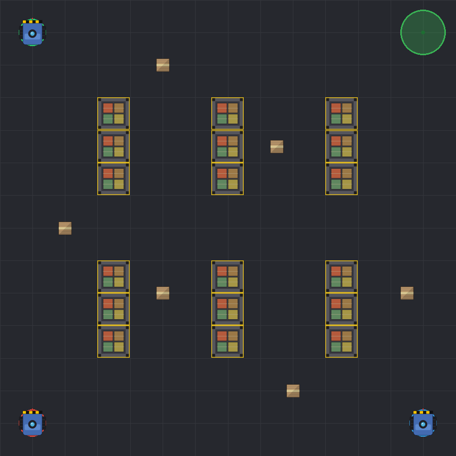

# Warehouse Robot RL


A custom **Gymnasium / PettingZoo** environment where robots drive around a 2D
warehouse, pick up packages and deliver them to a base — trained with **PPO**
and **SAC** from [Stable-Baselines3](https://github.com/DLR-RM/stable-baselines3).

The project covers the full arc: a continuous-control single-agent environment,
a cooperative multi-agent extension, homogeneous (parameter-sharing) and
heterogeneous (mixed-algorithm) training, evaluation and visualisation — all
behind one `warehouse` CLI.

| Homogeneous (shared PPO policy) | Heterogeneous (PPO + PPO + SAC) |
| :---: | :---: |
|  |  |

## Highlights

- **Custom continuous-control environment** (`WarehouseRobotEnv`): acceleration
  control, circle–rectangle collisions, 8 distance sensors, reward shaping, a
  speed-gated pickup/delivery rule that forces strategic slowing-down.
- **Multi-agent environment** (`WarehouseMultiEnv`, PettingZoo `ParallelEnv`):
  3 cooperating robots, shared team reward, robot-as-obstacle collisions.
- **Three training regimes**: single-agent PPO, homogeneous parameter sharing,
  and heterogeneous round-robin self-play where three different algorithms
  cooperate inside a single episode.
- **One CLI** for training, sweeping, evaluating and visualising.

## Install

Requires Python 3.12+ and [uv](https://docs.astral.sh/uv/).

```bash
uv sync                 # runtime deps
uv sync --extra report  # + jupyter / matplotlib / tensorboard for the notebooks
```

## Quickstart

The repo ships a small set of pretrained demo models under `examples/`, so you
can see results immediately:

```bash
# Watch a trained single-agent policy (opens a pygame window)
uv run warehouse play --model examples/models/single_ppo.zip

# Evaluate a shared multi-agent policy and render a GIF
uv run warehouse eval homo \
    --model examples/models/homo_ppo_v1.zip --algo ppo \
    --episodes 30 --gif out.gif

# Evaluate a heterogeneous line-up (mixed algorithms in one episode)
uv run warehouse eval hetero \
    --model robot_0=ppo:examples/models/hetero/robot_0_ppo.zip \
    --model robot_1=ppo:examples/models/hetero/robot_1_ppo.zip \
    --model robot_2=sac:examples/models/hetero/robot_2_sac.zip \
    --episodes 30 --gif hetero.gif
```

## Training

```bash
# Single-agent PPO
uv run warehouse train single --layout random --steps 2_500_000

# Hyperparameter sweep (configs × seeds, multiprocessing)
uv run warehouse sweep --parallel 8

# Longer run of one config (e.g. the sweep winner)
uv run warehouse train long --config big_lr3e4

# Multi-agent, homogeneous (one shared policy)
uv run warehouse train multi homo --algo ppo --variant v1

# Multi-agent, heterogeneous (PPO + PPO + SAC, round-robin self-play)
uv run warehouse train multi hetero --rounds 5 --round-steps 200_000
```

Run `uv run warehouse --help` (or `--help` on any subcommand) for all options.

Training artifacts are written to `./models/` and `./logs/` (both git-ignored).
Set `WAREHOUSE_OUTPUT_DIR` to write them elsewhere.

## Project layout

```
src/warehouse/
├── cli.py              # Typer entry point (`warehouse ...`)
├── envs/
│   ├── single.py       # WarehouseRobotEnv (continuous single-agent)
│   ├── multi.py        # WarehouseMultiEnv (PettingZoo ParallelEnv)
│   └── wrappers.py     # PettingZoo ↔ SB3 vec-env / single-slot adapters
├── training/
│   ├── configs.py      # all hyperparameter presets in one place
│   ├── single.py · sweep.py · long.py
│   └── multi_homo.py · multi_hetero.py
├── eval/multi.py       # metrics + GIF rendering
├── render/play.py      # pygame visualisation
└── paths.py            # output-dir resolution
examples/               # curated demo models + gifs (tracked)
notebooks/              # analysis reports (rendered .html kept)
docs/design.md          # full environment specification (Polish)
```

## How it works

The single-agent robot is a circle controlled by 2D acceleration. It observes
its position/velocity, a vector to the current target, 8 ray-sampled distance
sensors and the number of remaining packages. A package is picked up (and
delivered) only when the robot is close **and** moving below a speed threshold,
which forces it to learn to slow down rather than fly through waypoints.
Collisions stop the robot and apply a penalty but do not end the episode.

The full environment specification lives in [`docs/design.md`](docs/design.md).

Analysis reports with training curves and evaluation metrics (rendered HTML):
[single-agent report](https://htmlpreview.github.io/?https://github.com/malekkonrad/warehouse/blob/main/notebooks/single_agent_report.html) ·
[multi-agent report](https://htmlpreview.github.io/?https://github.com/malekkonrad/warehouse/blob/main/notebooks/multi_agent_report.html).

---

Built as a reinforcement learning course project at AGH University of Krakow.
